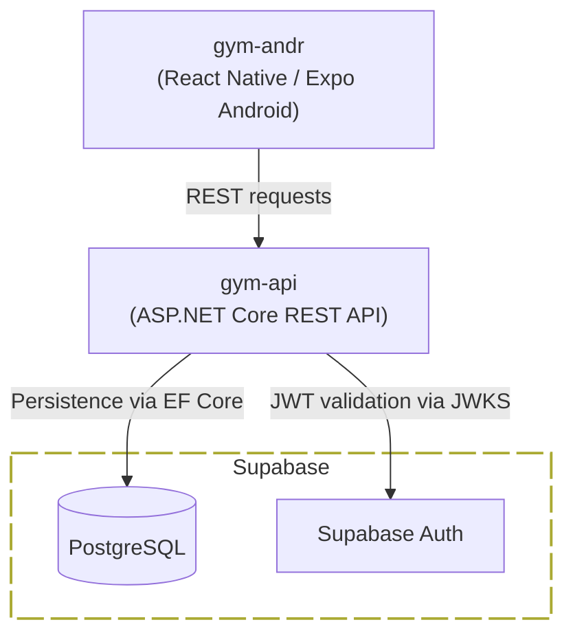

<h1> &nbsp;Kiss Gym</h1>

A gym training tracker focused on simplicity and flexibility. Start a session from
the previous exercise sequence and adapt it as you train.

## Key Components

| Repository | Tech | Description |
|-----------|------|-------------|
| [gym-api](https://github.com/kiss-gym/gym-api) | C# / ASP.NET Core | REST API for training sessions, exercises and user management; Supabase for data and authentication |
| [gym-andr](https://github.com/kiss-gym/gym-andr) | TypeScript / React Native / Expo | Primary Android client for tracking training sessions |

## Architecture Overview

## License

[MIT](https://github.com/kiss-gym/.github/blob/main/LICENSE)

## Contact

Eduard Danziger 
[github.com/eduarddanziger](https://github.com/eduarddanziger)
